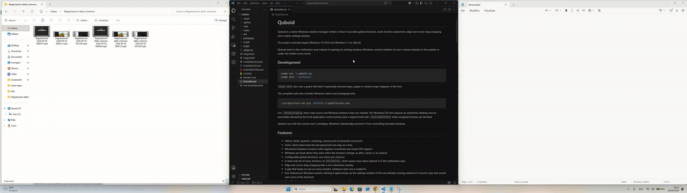

# Quboid

**Snap windows to halves, thirds and quarters with Rectangle's keyboard shortcuts — on Windows 10 and 11, across mixed-DPI monitors, with no network code.**

[](https://apps.microsoft.com/detail/9NJMQV24WD26?cid=readme)
[](https://github.com/SormanoS/quboid/releases/latest)
[](LICENSE)
[](#privacy)



## Quick start

```powershell
winget install --id 9NJMQV24WD26 --source msstore
```

Or get it from the [Microsoft Store](https://apps.microsoft.com/detail/9NJMQV24WD26?cid=readme), or download the [MSI installer or portable ZIP](https://github.com/SormanoS/quboid/releases/latest) (~3.6 MB download, no administrator rights needed).

On first launch Quboid opens its shortcut sheet so you can see every command right away. After that it stays in the Windows notification area (system tray) — press **Ctrl+Alt+←** to snap the active window left, and **Ctrl+Alt+S** at any time to bring up the shortcut list.

## Why Quboid?

- **Rectangle's shortcuts, on Windows.** The same default layout as [Rectangle](https://rectangleapp.com/) on macOS: halves, quarters, thirds, two-thirds, center, maximize height, restore and multi-step undo. Every shortcut can be remapped, and Quboid tells you on its tray icon and in the editor when another app has already taken one.
- **Made for several monitors and for docking.** Move windows between monitors with different scaling, even ones placed left of or above the main display (negative coordinates). A configurable gap is scaled to each monitor's effective DPI so it looks identical on a 4K panel at 200% and a 1080p panel at 100%. After you dock or undock, Quboid waits for the display topology to settle and puts the windows it placed back on the same fraction of their display.
- **Private by construction.** No telemetry, no accounts, no crash uploads, no update checks. The executable imports no networking library and `Cargo.lock` contains no networking crates — both are enforced in CI and [verifiable in one command](#privacy).
- **Small and quiet.** A single native Rust executable (~8.4 MB unpacked, ~3.6 MB installer, 0% CPU at idle) with an English and Italian UI, edge and corner drag snapping, launch at login, and a portable ZIP mode that keeps `config.json` and logs next to the executable on a USB stick.

## Default shortcuts

| Move the active window to… | Shortcut |
| --- | --- |
| Left, right, top or bottom half | `Ctrl+Alt+←` `→` `↑` `↓` |
| Top-left, top-right, bottom-left or bottom-right quarter | `Ctrl+Alt+U` `I` `J` `K` |
| First, center or last third | `Ctrl+Alt+D` `F` `G` |
| First, center or last two thirds | `Ctrl+Alt+E` `R` `T` |
| Maximize / Maximize height | `Ctrl+Alt+Enter` / `Ctrl+Alt+Shift+↑` |
| Center / Restore original size | `Ctrl+Alt+C` / `Ctrl+Alt+Backspace` |
| Grow / Shrink | `Ctrl+Alt++` / `Ctrl+Alt+-` |
| Previous or next monitor | `Ctrl+Alt+Win+←` `→` |
| Undo the last placement | `Ctrl+Alt+Z` |
| See every shortcut (cheat-sheet) | `Ctrl+Alt+S` |

Additional actions (`Center half`, `Almost maximize`, and directional step moves) are available in the **Actions** and **Shortcuts** tabs and can be bound to any key combination.

## How it compares

| Tool | Approach | When to pick it instead | How Quboid differs |
| --- | --- | --- | --- |
| **Windows 11 Snap** | Built-in (`Win+Arrows`, `Win+Z` Snap Layouts) | You only need basic halves or the mouse popup menu on Windows 11 | Direct single-stroke shortcuts for thirds, two-thirds and quarters; multi-step undo; DPI-scaled gap; works on Windows 10 22H2 too |
| **FancyZones (PowerToys)** | Custom zones inside a 20+ utility suite | You want hand-drawn zone templates and already use PowerToys | Standalone executable; instant keyboard shortcuts for every layout without holding `Shift` while dragging; Rectangle defaults |
| **komorebi / GlazeWM** | Automatic tiling window managers with config files | You want every window tiled automatically like i3 or bspwm | Not a tiling WM: moves only the window you ask it to move and leaves the rest alone; native GUI settings, zero config files |
| **AltSnap** | `Alt` + mouse drag anywhere inside a window | You prefer positioning windows with the mouse | Built around keyboard shortcuts and automatic restore after dock/undock |
| **AquaSnap / DisplayFusion** | Proprietary desktop suites | You need multi-monitor taskbars, wallpaper tools or window tabbing | Free and open source (GPLv3), verifiable offline binary |

### When Quboid is not for you

Quboid moves the window you ask it to move and leaves every other window alone. If you want a tiling window manager that arranges every window automatically, look at [komorebi](https://github.com/LGUG2Z/komorebi) or [GlazeWM](https://github.com/glzr-io/glazewm). If you want custom zones you draw yourself, [FancyZones](https://learn.microsoft.com/windows/powertoys/fancyzones) in PowerToys does that well.

## FAQ

<details>
<summary><strong>Can Quboid move windows that run as administrator?</strong></summary>

No. Quboid runs with your normal user account (`asInvoker`) and never asks for administrator privileges. Windows blocks non-elevated programs from moving or resizing elevated windows (User Interface Privilege Isolation, UIPI). When you press a shortcut on an administrator window, Quboid reports that Windows prevented the action in its status bar.
</details>

<details>
<summary><strong>Windows 11 already has Snap Layouts. Why use Quboid?</strong></summary>

Windows 11's `Win+Z` menu requires picking a layout and then picking a slot in it. Quboid gives every layout — including thirds, two-thirds, quarters, center, grow/shrink and multi-step undo (`Ctrl+Alt+Z`) — a direct keyboard shortcut that matches Rectangle on macOS, scales the gap to each monitor's DPI, and works the same way on Windows 10 22H2 and Windows 11.
</details>

<details>
<summary><strong>Do my windows go back where they were after I dock or undock my laptop?</strong></summary>

Yes. Every window Quboid places is remembered as the fraction of a named display's work area it covers. When monitors connect, disconnect or change resolution, Quboid waits 2 seconds for the display topology to stop changing and puts those windows back on the same display at the same fraction of its work area. Windows you minimized, maximized, closed or moved by hand are left untouched.
</details>

<details>
<summary><strong>Where is Quboid after I close the window?</strong></summary>

Closing the settings window hides Quboid to the Windows notification area (system tray) so global shortcuts keep working. On Windows 11, new tray icons appear inside the hidden-icons menu (`^` next to the clock) until you drag them onto the taskbar. You can open Quboid at any time by pressing **`Ctrl+Alt+S`**, clicking its tray icon, or launching Quboid again from the Start menu (starting a second instance brings up the one already running).
</details>

<details>
<summary><strong>Why does <code>AltGr</code> trigger a shortcut on some European keyboard layouts?</strong></summary>

On Windows, pressing `AltGr` sends `Ctrl+Alt`. On layouts where `AltGr` types third-level characters — such as `AltGr+E` for `€` on Italian and German keyboards, or `AltGr+C/E/S/Z` on Polish keyboards — Windows treats that key press as `Ctrl+Alt+<key>`. Open Quboid's **Shortcuts** tab to remap or remove any `Ctrl+Alt` binding that collides with a character you type with `AltGr`.
</details>

<details>
<summary><strong>Windows SmartScreen warns me about the MSI or portable ZIP. Is it safe?</strong></summary>

The [Microsoft Store](https://apps.microsoft.com/detail/9NJMQV24WD26?cid=readme) and `winget` (`--source msstore`) builds are signed by Microsoft and install without warnings. The standalone `.msi` and `.zip` on GitHub Releases are built directly from this repository by [`.github/workflows/release.yml`](.github/workflows/release.yml) with SHA-256 checksums, but they are not signed with a commercial Authenticode certificate yet, so SmartScreen warns on first run.
</details>

## Privacy

Quboid collects nothing and sends nothing. You don't have to take our word for it: the executable imports no networking library, and CI fails if a networking crate or DLL import ever appears.

```powershell
dumpbin /imports quboid-app.exe | Select-String -Pattern 'ws2_32|winhttp|wininet|mswsock|dnsapi|iphlpapi|urlmon'
# prints nothing
```

What Quboid stores locally (`config.json` and a rolling local diagnostic log), and where, is documented in [`PRIVACY.md`](PRIVACY.md).

## Community and contributing

- **Questions and ideas:** [GitHub Discussions](https://github.com/SormanoS/quboid/discussions)
- **Bug reports and feature requests:** [GitHub Issues](https://github.com/SormanoS/quboid/issues/new/choose)
- **Display Lab:** share your multi-monitor / mixed-DPI setup via the [Display setup report](https://github.com/SormanoS/quboid/issues/new?template=display_setup.yml) to help grow [`docs/tested-setups.md`](docs/tested-setups.md)
- **First contributions:** browse [`good first issue`](https://github.com/SormanoS/quboid/labels/good%20first%20issue) and [`help wanted`](https://github.com/SormanoS/quboid/labels/help%20wanted)

If Quboid saves you time, a ⭐ on GitHub or a short review on the [Microsoft Store](https://apps.microsoft.com/detail/9NJMQV24WD26?cid=readme) helps other Windows users find it.

## License and how Quboid is funded

Copyright (C) 2026 Samuele Sormano.

Quboid is free software, distributed under the **GNU General Public License, version 3** ([`LICENSE`](LICENSE)). You may use, study, modify and redistribute it under the terms of the GPL v3.

To keep development sustainable while keeping this repository free, open source and telemetry-free forever, code contributions are accepted under the contributor agreement in [`CONTRIBUTING.md`](CONTRIBUTING.md), which also allows the author to offer commercial licenses or build paid extensions on top of the same core. Every version published from this repository remains GPL v3. Opening issues, reporting bugs, sharing display setups and participating in discussions require no agreement.

## Documentation and trust

- **Developer docs:** [Building and architecture (`docs/BUILDING.md`)](docs/BUILDING.md) · [Releasing (`docs/RELEASING.md`)](docs/RELEASING.md) · [Tested monitor setups (`docs/tested-setups.md`)](docs/tested-setups.md)
- **Trust:** [`LICENSE`](LICENSE) · [`PRIVACY.md`](PRIVACY.md) · [`SECURITY.md`](SECURITY.md) · [`CODE_OF_CONDUCT.md`](CODE_OF_CONDUCT.md) · [`CONTRIBUTING.md`](CONTRIBUTING.md)

